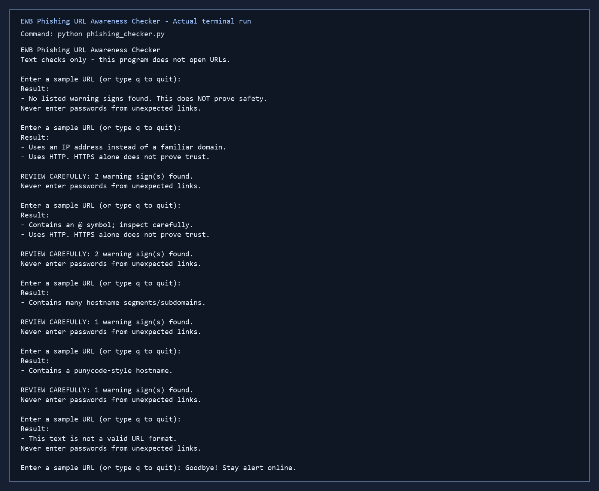
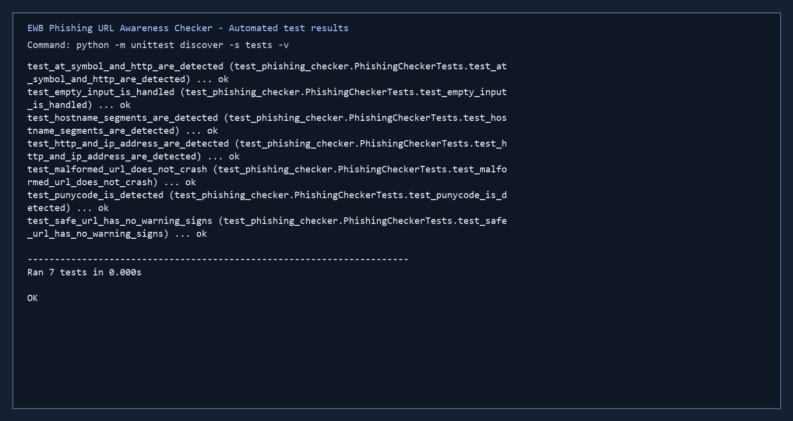

# EWB Phishing URL Awareness Checker

## Overview

Phishing is a trick that uses a fake link or message to make someone reveal private information. This beginner-friendly Python tool reads submitted URL text and reports six visible warning signs without opening the URL or sending it anywhere.

## Project Overview

This project helps users learn how to spot common phishing tactics in URLs without sending any network requests or executing external code. It is a local-only awareness tool designed for educational use and demonstration.

## Features

- Detects an `@` symbol in the URL
- Flags unusually long URLs (over 100 characters)
- Flags IP-address hostnames
- Flags many hostname segments (5 or more)
- Flags punycode-style hostnames (`xn--`)
- Flags the HTTP scheme
- Repeats checks until the user types `q`, `quit`, or `exit`
- Prints a `REVIEW CAREFULLY` summary when real warnings are found
- Handles malformed URL text without crashing

## Requirements

Python 3.10 or later. No extra packages.

## Tools and Technologies

- Python 3.10 or newer
- Standard library only
- `unittest` for automated test validation

## Installation and Setup for Windows 10

1. Open a terminal in the project folder.
2. Ensure Python 3.10+ is installed.
3. Run the following:

```powershell
python -m venv .venv
.venv\Scripts\Activate.ps1
python -m pip install --upgrade pip
```

## How to Run

Windows:

```powershell
python phishing_checker.py
```

Mac/Linux:

```sh
python3 phishing_checker.py
```

When the prompt appears, enter a workbook sample URL. Type `q` to finish.

## How to Run the Program in VS Code

1. Open the project folder in VS Code.
2. Open the integrated terminal.
3. Activate the environment if needed.
4. Run:

```powershell
python phishing_checker.py
```

Then enter a URL such as:

- `https://www.example.com/login`
- `http://192.0.2.10/account`
- `http://example.com@sample.invalid/login`

## Explanation of the Six Warning Rules

1. `@ symbol`: Detect the presence of an `@` symbol.
2. `URL length`: Flag URLs longer than 100 characters.
3. `IP-address hostname`: Detect an IPv4 address used as the hostname.
4. `Hostname segments`: Flag hostnames containing five or more dot-separated segments.
5. `Punycode`: Detect `xn--` in the hostname.
6. `HTTP scheme`: Flag URLs using HTTP rather than HTTPS.

## Sample Input and Expected Output

### Example 1
Input:

```text
https://www.example.com/login
```

Expected output:

- No warning signs detected

### Example 2
Input:

```text
http://192.0.2.10/account
```

Example output:

```text
Uses an IP address instead of a familiar domain.
Uses HTTP. HTTPS alone does not prove trust.
REVIEW CAREFULLY: 2 warning sign(s) found.
```

### Example 3
Input:

```text
https://example.com@evil.com
```

Example output:

```text
Contains an @ symbol; inspect carefully.
Uses HTTP. HTTPS alone does not prove trust.
REVIEW CAREFULLY: 2 warning sign(s) found.
```

### Example 4
Input:

```text
https://a.b.c.d.e.f/very-long-path
```

Example output:

```text
Contains many hostname segments/subdomains.
REVIEW CAREFULLY: 1 warning sign(s) found.
```

### Example 5
Input:

```text
https://xn--example.com
```

Example output:

```text
Contains a punycode-style hostname.
REVIEW CAREFULLY: 1 warning sign(s) found.
```

## Testing

| # | Input | Expected | Actual | Result |
|---|-------|----------|--------|--------|
| 1 | `https://www.example.com/login` | No warning signs | No listed warning signs found | PASS |
| 2 | `http://192.0.2.10/account` | IP address + HTTP | Both exact warning messages | PASS |
| 3 | `http://example.com@sample.invalid/login` | @ symbol + HTTP | Both exact warning messages | PASS |
| 4 | `https://a.b.c.d.e.example.invalid/path` | Many hostname segments | Exact hostname-segment warning | PASS |
| 5 | `https://xn--example.invalid/` | Punycode-style hostname | Exact punycode warning | PASS |

Run the automated checks with:

```powershell
python -m unittest discover -s tests -v
```

See [tests/test_samples.md](tests/test_samples.md) for the full evidence table.

## Screenshots




## Improvements

1. Repeat-check loop - lets a user inspect several URLs before typing `q` to quit.
2. Review-carefully summary - adds a clear count of findings after real warnings. It was checked with all five workbook samples.
3. Malformed-input handling - catches an invalid parsed URL and shows a safe message instead of crashing.

## Limitations

This is an educational tool. It only reads URL text and cannot open URLs, scan malware, query reputation services, or prove that a URL is safe. No warning signs found does NOT mean a URL is safe.

## Ethical Use

Use the workbook sample strings only. Do not collect passwords or credentials, and do not use this project to deceive anyone or test websites without permission.

## GitHub Publication Instructions

1. Initialize Git in the project folder.
2. Create a repository on GitHub.
3. Add all project files.
4. Commit the project.
5. Push to the remote repository.
6. Confirm the public repo is accessible.

## Author

Preslie Aadi Fernandes, EWB Courses cybersecurity mini-project.

## Summary

This project demonstrates how simple heuristics can help raise awareness about suspicious URLs without relying on external services or automation. It is intended for learning, testing, and safe local use only.
